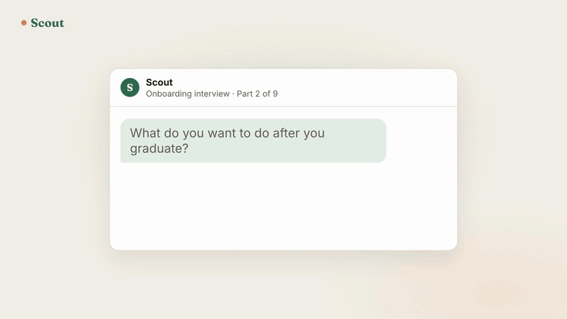

<p align="center">
  <a href="media/scout-launch.mp4"></a>
  <br>
  <a href="media/scout-launch.mp4">Watch with sound</a>
</p>

# Scout

Scout is an AI skill that runs your job search with you. It reads your resume and LinkedIn, asks you a few sharp questions, and writes a profile of what you're actually looking for. Then every week it finds roles that fit, researches each company, tailors your resume to the story that company wants to hear, drafts your answers and fills in the application. You read it over and click Submit.

Built for college students and new grads. Works in Claude Code, Cowork and Codex, and in ChatGPT through a Project.

## How it works

1. **Setup, about 10 minutes.** Scout reads your resume and LinkedIn first, so it only asks what they can't tell it: what you enjoyed most and least, whose job you'd take, how you like to work, and your limits on location, pay and start date. Seven questions, one at a time, and it pushes back on vague answers.
2. **Your profile.** Everything lands in `profile.md`: hard filters, ranked directions, a scoring rubric, and a "reading between the lines" section where Scout writes what your answers say that you didn't, with the evidence. You rate your first batch of roles so it can check its read on you.
3. **Find and vet.** Each week Scout checks your job-alert emails, company job boards, LinkedIn and startup boards, reads every full posting, and keeps only the roles that pass your filters. You confirm the week's batch.
4. **Research.** One brief per role: the story the ideal candidate's resume tells, which signals you're strong or missing on, and the company's own language.
5. **Fill the gaps.** Scout asks about things you've probably done but left off your resume. Nothing goes on a resume until you confirm it.
6. **Tailor.** A one-page resume per role, true line by line, in your own resume's formatting, as .docx and PDF.
7. **Answers.** "Why us" answers built from the company's stated values and your real reasons, in your voice.
8. **Apply.** Scout fills the application in your own browser. You add anything personal, tick the legal boxes and submit.
9. **Outreach.** Warm messages to alumni and people tied to the role, asking for a short call, not a referral. You send them.

It keeps a tracker of every role and conversation, and it learns from what you pass on.

## Three rules it never breaks

- **You make every final click.** Scout never submits an application, sends a message or signs anything for you.
- **Nothing made up.** Every resume line and form answer comes from facts you confirmed.
- **You handle passwords and accounts.** Scout never types a password or creates an account.

## What you need

- **Your resume.** A Word file (.docx) is best, since Scout keeps your formatting when it tailors it. A PDF works too.
- **Your LinkedIn profile.** Recommended, not required. It fills in what your resume leaves out.
- **One of these AI apps:** Claude Code or Cowork (paid Claude plan), Codex, or ChatGPT with Projects.
- **A browser Scout can work in, signed in to LinkedIn.** That's the Claude in Chrome extension for Claude Code and Cowork, agent mode in ChatGPT, or a browser tool connected to Codex. Scout uses it to read your LinkedIn, search LinkedIn jobs, find alumni and fill applications. No connector can read LinkedIn, so a browser is the only way in. Without one, save your LinkedIn profile as a PDF (Resources, then Save to PDF), and Scout gives you an answer sheet to paste into applications.
- **Python 3,** which most Macs already have, for Claude Code, Cowork and Codex. Scout installs the one library it needs the first time it builds a resume. ChatGPT uses its own built-in Python.
- **Optional:** an email connector, so Scout can read your job-alert emails, and a job-search connector like ZipRecruiter for more listings.

## Install

You need access to this repo. Then pick your app.

### Claude Code

Download [`dist/scout.skill`](dist/scout.skill), then:

```bash
mkdir -p ~/.claude/skills && unzip -o ~/Downloads/scout.skill -d ~/.claude/skills/
```

### Cowork

Download [`dist/scout.skill`](dist/scout.skill), drag it into Cowork and click **Save skill**.

### Codex

Download [`dist/scout.skill`](dist/scout.skill), then:

```bash
mkdir -p ~/.agents/skills && unzip -o ~/Downloads/scout.skill -d ~/.agents/skills/
```

### ChatGPT

ChatGPT can't keep files in a folder between chats, so a Project holds them instead.

1. Download the two files in [`dist/chatgpt/`](dist/chatgpt): `scout-chatgpt.md` and `resume.py`.
2. In ChatGPT, create a Project called **Job Search** and add both files to it.
3. Paste this into the Project's instructions:

   ```text
   You are Scout, a job-search partner for students and new grads. The project file scout-chatgpt.md is your full playbook: follow it, starting with "Start of every session" and the ChatGPT section of references/platforms.md. This Project is my job-search folder: profile.md, facts.md and tracker.md are project files you read at the start of every chat. You can't edit project files, so whenever one changes, give me the complete updated file to download before I leave and tell me which project file to replace.
   ```

ChatGPT can read project files but can't change them, so at the end of each session Scout hands you updated copies of your profile, facts and tracker to swap in. Its Python has no internet, so Scout finds roles with web search instead of reading company job boards directly.

## Start

**Claude Code, Cowork or Codex:** make a folder for your search (say, `Job Search`) and open it in your app (in Cowork, share the folder). Say **"set up Scout"** (in Codex you can also type `$scout`).

**ChatGPT:** start a new chat inside your Job Search Project and say **"set up Scout"**.

Have your resume file and LinkedIn URL ready; Scout asks for them first. After that, come back and say "what's next" whenever you sit down to work on your search.

Scout keeps everything in that folder, or in the Project on ChatGPT:

| File | What it holds |
|---|---|
| `profile.md` | Who you are and what you want. Every search starts here. |
| `facts.md` | Confirmed facts, numbers, stories and standing form answers. |
| `tracker.md` | Every role and outreach, its stage, and what's next. |
| `resumes/` | Your original resume, untouched, plus one tailored version per role. |
| `research/` | One brief per role, plus your approved answers. |

They're plain text, so you can read and edit all of them.

## Repo layout

| Path | What it is |
|---|---|
| `scout/` | The skill source. Zipped as is, and the folder name is part of the format. `scout/references/platforms.md` covers each app. |
| `dist/scout.skill` | The built skill for Claude Code, Cowork and Codex. |
| `dist/chatgpt/` | The same playbook as one file, plus the resume script, for a ChatGPT Project. |
| `build.sh` | Rebuilds everything in `dist/` after any change. |
| `media/` | The launch video (made with /brag) and the GIF version shown above. |

## Status

Private beta, free to testers. Built by Cole Brashear from the process he used for his own new-grad search. Found a bug or a site that breaks it? Open an issue.
